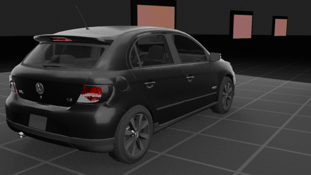

# Rodrigo Schmitt de Almeida

Estudante de Engenharia de Software (PUCRS) com foco em **telemetria automotiva**, **engenharia backend & AppSec**, **análise em grafos** e **IA aplicada**.

### Portfólio 3D Interativo — VW Gol G5

Conduza um **Volkswagen Gol G5 Preto** em Three.js e Blender 5.1 por estações interativas com demonstrações reais dos principais projetos:

  
  &nbsp;&nbsp;
  

---

### Projetos em Destaque

| Projeto | Descrição | Stack Principal |
|---|---|---|
| [**leitorECU**](https://github.com/RodrigoSchmittDeAlmeida/leitorECU) | Scanner e datalogger automotivo multiplataforma (Desktop 30 FPS + Mobile/Tablet Flutter) com osciloscópio triplo, Mapa 2D, Replay e exportação CSV/.msl sobre CAN UDS, KWP2000, KW1281 e OBD-II. | Python, PyQt6, PyQtGraph, Flutter, Bleak BLE |
| [**V-Stable**](https://github.com/RodrigoSchmittDeAlmeida/v-stable-frontend) ([backend](https://github.com/RodrigoSchmittDeAlmeida/v-stable-backend)) | Plataforma B2B de câmbio e stablecoins com sanitizador de mídia em Rust (`zero-unsafe`), 2FA TOTP (RFC 6238), 37/37 testes de pentest STRIDE e chatbot Zero-PII com rate-limit de Nielsen. | Java 25, Spring Boot 4, React 19, PostgreSQL 16, Rust, AWS |
| [**OrdoVitae**](https://github.com/Hacktona-AGES-2026/OrdoVitae) | Sistema de priorização cirúrgica no SUS (9ª Hackatona PUCRS / HSL) combinando regras clínicas SWALIS e DeepSeek-V3 com validação literal e 0% de alucinação. | Python, FastAPI, SQLite, DeepSeek-V3, React 19 |
| **Vincula** *(AGES / PUCRS)* | Plataforma investigativa em grafo interativo para cruzamento de quebras de sigilo SIMBA, SITTEL, RIF e extratos bancários CNAB/CSV/XLSX. | Next.js 15, React 19, `@neo4j-nvl/react`, Material UI |
| [**T2IA**](https://github.com/RodrigoSchmittDeAlmeida/T2IA) | Rede neural MLP (9-18-9) em Python puro evoluída por Algoritmo Genético (`BLX-α` + elitismo + currículo) contra Minimax no Jogo da Velha, com visualizador Tkinter. | Python, MLP, Algoritmo Genético, Minimax, Tkinter |
| [**Smart Talent**](https://github.com/RodrigoSchmittDeAlmeida/Grupo8-Smart-Talent) | Torre de decisão logística sobre 180.519 pedidos DataCo Supply Chain com Random Forest (`83,22%` de precisão na classe 1) e API em container. | Python, Pandas, Scikit-Learn, FastAPI, Docker |

---

### Tecnologias Principais

- **Linguagens:** Python, Java, TypeScript, JavaScript, Rust, SQL
- **Backend & Dados:** Spring Boot, FastAPI, PostgreSQL (Flyway), SQLite, Pandas, Scikit-Learn
- **Frontend & 3D:** React, Next.js, Three.js, Vite, Material UI, Blender
- **Qualidade & Segurança:** Pytest, Vitest, SpotBugs/FindSecBugs, Pentest STRIDE, Docker, GitHub Actions
